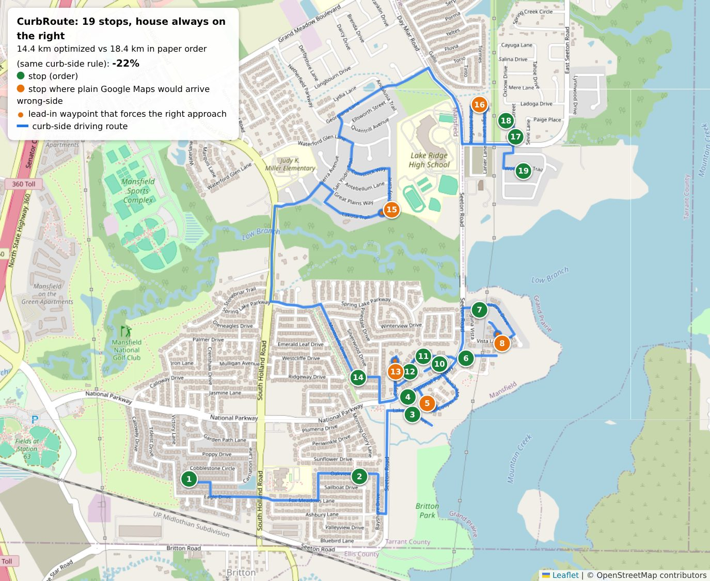

# CurbRoute

Photograph the paper route sheet, get back **one optimized driving route where every house ends up on the passenger side of the truck** (where the hose is), then drive it in Google Maps.



*A real 19-stop Mansfield / Grand Prairie sheet (house numbers shifted for privacy). Orange stops are where plain Google Maps would bring you in on the wrong side. The small orange dots are the lead-in waypoints the app adds to prevent that.*

| Same 19 stops, house always on the right | Distance | Drive time |
|---|---|---|
| Paper order | 18.4 km | 35 min |
| **CurbRoute order** | **14.4 km** | **27 min** |
| Saved | **4.0 km (22%)** | **8 min** |

For reference, the paper order *ignoring* which side the house is on is 10.6 km. But on the real sheet, the shortest path between consecutive stops arrives wrong-side on 16 of 18 legs, which today you pay for in hose drags and driveway U-turns. The curb-side rule costs real distance; the optimizer wins most of it back.

---

## How it works


1. **OCR** (`app/.../ocr/SheetOcr.kt`): Google ML Kit text recognition runs **on the phone**. It's free, works offline, and the photo is never uploaded. Lines are sorted along the page's own tilt, so a crooked photo still reads top to bottom.
2. **Parse** (`core/.../parse/RouteSheetParser.kt`): pulls `house# street city, ST ZIP` off each line and fixes OCR letter/digit swaps (`42O7` → `4207`). It maps sheet abbreviations to USPS ones (`Cr` → `Cir`, `Tr` → `Trl`) and ignores your pen marks. The 114/150 hand-written numbers look exactly like circled stop numbers to OCR, so only a number that fits the 10-20-30 sequence at that spot is accepted. It also drops rows repeated on overlapping photos and warns when a stop number is missing (a skipped row).
3. **Geocode** (`core/.../geo/Geocoding.kt`): the **US Census geocoder** is free, needs no key, and is fine for commercial use. Its points sit a few meters off the street centerline *on the house's side*, and that offset is what tells the router which side the house is on. If Census misses, it falls back to the phone's built-in geocoder, then OpenStreetMap. Every answer is cached. Customers repeat every 6-8 weeks, so after the first lap lookups are instant.
4. **Curb-side matrix** (`core/.../routing/OsrmRouter.kt`): asks OSRM, an open-source routing engine, for the drive distance between every pair of stops with `approaches=curb`. That means "arrive with it on the curb side, leave the way you're parked". A→B is no longer B→A, because one direction might need a lap around the block.
5. **Optimize** (`core/.../solve/RouteSolver.kt`): an asymmetric traveling-salesman solver. Up to 15 stops it's solved exactly (Held-Karp). Past that it uses iterated local search: Or-opt, 2-opt, double-bridge kicks and restarts. It matches the proven optimum in every test case, and 60 stops take ~0.3 s on a PC.
6. **Wrong-side check + Maps links** (`core/.../CurbRoutePlanner.kt`, `nav/GoogleMapsLinks.kt`): for each leg it asks "would a curb-*unaware* app (Google Maps) take a shorter path that arrives on the wrong side?". Where the answer is yes, it drops a waypoint ~60 m before the house on the correct approach, so Maps has to come in the right way. The route is then split into Maps links of ≤ 9 waypoints each, which is the Android Maps app's limit.

---

## The big decision: own navigation vs. hand off to Google Maps

**Handing plain stops to Google Maps doesn't work by itself.** Maps can't be told "arrive with it on my right"; Maps URLs have no side-of-road option. On the example sheet, a curb-unaware navigator that still knows which way you're facing would bring you in wrong-side on **5 of 18 legs**. The optimized *order* is only half the job.

| Option | Curb-side guaranteed? | Cost | Effort | Verdict |
|---|---|---|---|---|
| **A. Optimize in-app → Google Maps links + lead-in waypoints** *(built)* | Mostly. Holds unless Maps re-routes after a missed turn. | $0 | Low | **Ship first** |
| B. Same, but no lead-ins | No, ~1 in 4 stops wrong-side | $0 | Lowest | ✗ |
| C. In-app turn-by-turn, Google Navigation SDK `setPreferSameSideOfRoad(true)` | Yes | 1,000 destinations/mo free, then $25 per 1,000 | Medium-High | **Upgrade path** |
| D. In-app nav, Mapbox Navigation SDK `APPROACH_CURB` | Yes | 100 users + 1,000 trips/mo free | Medium-High | Alternative to C |
| E. Export route geometry as GPX → OsmAnd "navigate by track" | Yes (follows exact path) | $0 | Low | Nice hack, clunkier UX |

Why A first: it's free and has no API keys or billing account. You keep the Maps app you already trust (traffic, voice, Android Auto), and the optimizer is built so the navigation layer can be swapped later without touching it.

### Service options (checked Sept 2026)

| Service | Curb-side support | Free tier | After that | Catch |
|---|---|---|---|---|
| OSRM public demo | `approaches=curb` | free | n/a | **Testing only:** non-commercial, ≤ 1 req/s, no uptime promise |
| **OSRM self-hosted** | `approaches=curb` | free | free | You run a small server (see below) |
| Google Route Optimization API | `sideOfRoad`, time windows | 5,000 stops/mo | $10 / 1,000 | OAuth service account only, so it needs a small backend |
| Google Routes / Route Matrix | `sideOfRoad` (bills as Pro) | 5,000/mo | $10 / 1,000 elements | Unverified whether the matrix honors it per cell |
| Mapbox Matrix API | `approaches=curb` | 100,000 elements/mo | $2 / 1,000 | 25 coordinates per request |
| GraphHopper | `curbside` everywhere | Free plan: 5 locations, non-commercial | €69+/mo | Not viable on free |
| Google Maps links | none | free | free | 9 waypoints per link |
| Census geocoder | n/a | free | free | US only, needs internet |
| ML Kit text recognition | n/a | free, on-device | free | Adds ~11 MB of native code per CPU type |

At 20-60 stops/day × ~22 days that's ~440-1,320 stops a month. Every paid option above would sit inside or near its free tier.

---

## Setup

### 1. Try it on your PC first (no phone needed)

**Environment:** any terminal (PowerShell on Windows, the VS Code terminal, etc.). **Needs:** Java 17 or newer ([Temurin](https://adoptium.net/) is the easy install).

```powershell
cd path\to\Slagathore\curbroute
.\gradlew.bat :cli:run --args="core/src/test/resources/sheet-2026-09-29.txt"
```
(macOS/Linux: `./gradlew` instead of `.\gradlew.bat`.)

**Expect:** the first run downloads Gradle and libraries, which takes a few minutes. Then you get the 19 parsed stops, the optimized order with `forced approach` notes, the km/min saved, and 3 Google Maps links. Paste one into your phone's browser and it opens in Maps.

Your own sheet: put one address per line in a `.txt` file (`123 Some Dr Mansfield, TX 76063`) and pass that file instead. Add `--geojson route.geojson` and drag the file onto <https://geojson.io> to see the route on a map. Add `--start 32.55,-97.07` to start from a fixed spot.

Run the tests: `.\gradlew.bat :core:test` (19 tests: parser, solver vs. proven optimum, link splitting, OSRM request tiling, full planner).

### 2. Put the app on your phone

1. Install [Android Studio](https://developer.android.com/studio).
2. **File → Open → select the `curbroute` folder** (not the repo root). Let Gradle sync finish (bottom status bar).
   If it offers to upgrade the Android Gradle Plugin to 9.x, **decline for now**. That upgrade changes the build scripts, and I can do it with you as a separate step.
3. On the phone: Settings → About phone → tap *Build number* 7 times → back to Settings → Developer options → enable **USB debugging**. Plug the phone in and accept the prompt.
4. Pick your phone in the device dropdown and press **Run ▶**.

**No Android Studio?** `.\gradlew.bat :app:assembleDebug` (needs the Android SDK), then copy `app/build/outputs/apk/debug/app-arm64-v8a-debug.apk` to the phone and open it. Allow "install unknown apps" when asked.

**Using it:** *Take photo of a page* → check the list (tap a stop to fix a misread address, uncheck skips/cancellations) → *Optimize* → open *Google Maps part 1*. When Maps finishes part 1, come back and open part 2. Check stops off as you go. The list survives the app being closed.

### 3. Your own routing server (do this before daily use)

The public OSRM demo is for testing. A home server with Docker works: you already run the *arr stack, and this is the same kind of thing. Clip the map to DFW first so processing needs a few GB of RAM instead of the whole state's worth (commands for a Debian/Ubuntu box):

```bash
mkdir osrm && cd osrm
wget https://download.geofabrik.de/north-america/us/texas-latest.osm.pbf
sudo apt install -y osmium-tool
osmium extract -b -97.6,32.3,-96.5,33.2 texas-latest.osm.pbf -o dfw.osm.pbf   # DFW bounding box
docker run --rm -v "$PWD:/data" ghcr.io/project-osrm/osrm-backend osrm-extract -p /opt/car.lua /data/dfw.osm.pbf
docker run --rm -v "$PWD:/data" ghcr.io/project-osrm/osrm-backend osrm-partition /data/dfw.osrm
docker run --rm -v "$PWD:/data" ghcr.io/project-osrm/osrm-backend osrm-customize /data/dfw.osrm
docker run -d --restart unless-stopped -p 5000:5000 -v "$PWD:/data" ghcr.io/project-osrm/osrm-backend \
  osrm-routed --algorithm mld --max-table-size 200 /data/dfw.osrm
```

Test it: `curl "http://localhost:5000/route/v1/driving/-97.07,32.55;-97.05,32.57"` should return `"code":"Ok"`.

Reach it from the truck with [Tailscale](https://tailscale.com/). Use `tailscale serve --bg 5000` to get an **https://** address, because Android blocks plain `http://` by default. Paste that address into the app's ⚙ Settings → *Routing server*. Re-run the extract steps every month or two to pick up new subdivisions.

---

## Project layout

```
curbroute/
├── core/   Pure Kotlin, no Android. All the logic, unit-tested.
│   ├── parse/RouteSheetParser.kt   OCR text → stops
│   ├── geo/Geocoding.kt            Census / OSM / cache, GeoMath.kt
│   ├── routing/OsrmRouter.kt       curb-side matrix, route geometry
│   ├── solve/RouteSolver.kt        the optimizer
│   ├── nav/GoogleMapsLinks.kt      ≤9-waypoint Maps links
│   └── CurbRoutePlanner.kt         glues it all together
├── cli/    Terminal front-end for core (testing on a PC)
└── app/    Android app (Jetpack Compose, ML Kit, Play location)
    ├── ocr/SheetOcr.kt             photo → lines
    ├── platform/AndroidBits.kt     phone geocoder, GPS, launch Maps, camera file
    ├── RouteViewModel.kt           app state + saving it to disk
    └── ui/CurbRouteApp.kt          the three screens
```

---

## Honest limits (read before relying on it)

- **The app is compiled and lint-clean, but hasn't been run on a real phone yet.** The routing core is tested end to end against live services. The Android shell (camera → ML Kit → screens) is the part most likely to need a fix on first run.
- **The OCR parser was tested on text shaped like ML Kit output, not on ML Kit's actual output from your photos.** The review screen exists for exactly this reason: always glance at the list before optimizing.
- **Appointment times are ignored.** The sheet's call-ahead times were promised to customers, and reordering changes when you actually show up (on the example, the 6:45 AM stop moves to 14th of 19). The parser already captures the times; see the roadmap.
- **Lead-in waypoints aren't bulletproof.** Miss a turn and Maps re-routes to the house by the shortest path, which may be the wrong side. Maps also says "arrived" at the lead-in point. Just keep rolling.
- **Pins can be off.** Brand-new streets can be missing from Census, and the fallback geocoders may put the pin on the street centerline, which makes the side ambiguous. (The sheet's "Copper Cove Ct" is spelled "Cooper Cove Circle" in OpenStreetMap, for example.)
- **No U-turns at stops.** The model assumes you pull away the way you parked, which is right for a rig with a hose reel. Cul-de-sacs are handled because the routing engine knows they dead-end.

## Roadmap / TODO

- [ ] **Appointment windows**: soft time windows (e.g. ±90 min of the promised time, with a penalty per minute outside) plus a per-stop service time estimated from the sheet's *Area* column.
- [ ] **Hose-reach merge**: neighbors within hose reach on the same side become one parking stop (e.g. 5207/5213 Cool River Ct).
- [ ] **In-app map + pin fixing**: MapLibre/osmdroid map with the route line. Long-press to move a pin, saved forever via `CachingGeocoder.pin()`.
- [ ] **Census batch geocoding**: one request for the whole sheet instead of one per address.
- [ ] **Turn-by-turn in-app** (option C above) to drop the lead-in workaround entirely.
- [ ] **Vision-LLM fallback** for bad photos. More robust than regexes, but the photo (with customer names/phones) leaves the phone, so make it opt-in.
- [ ] **Skip OCR entirely**: ask the office whether their scheduling software can export the route as CSV/PDF.
- [ ] **Auto-fill the hand-written numbers**: they look like a lookup from the *Area* column (4.0 → 114, 6.0 → 127, 10 → 150, 15 → 189).
- [ ] **GitHub Actions** to build the APK on every push, so you can download it without Android Studio.
- [ ] Robolectric / Compose UI tests for the Android layer.

Map data © OpenStreetMap contributors. Geocoding by the U.S. Census Bureau.
